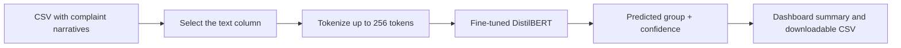

# Complaint Radar

Complaint Radar classifies free-form consumer finance complaints into a smaller,
consistent set of financial service groups. It is designed to help teams turn a
large CSV of unstructured complaint narratives into structured data that can be
filtered, summarized, and routed for further review.

Project Approach:

- consolidating related CFPB product labels into 11 broader groups;
- comparing a TF-IDF/logistic-regression baseline with a fine-tuned DistilBERT
  classifier; and
- providing a Streamlit interface for batch classification, visualization, and
  CSV export.

The model is intended to assist with triage and analysis. A prediction, especially
one with low confidence, should not replace human review or be treated as a legal
or compliance decision.

## How input becomes output



The app accepts a CSV containing one complaint-text column. It automatically
looks for common names such as `text`, `complaint`, `complaint_text`,
`consumer_complaint_narrative`, and `narrative`; any column can also be selected
manually.

For example, an input like this:

| complaint_id | text |
|---|---|
| 101 | My credit report still shows an account I already disputed. |
| 102 | The mortgage servicer charged fees I do not recognize. |

produces the original columns plus three prediction columns:

| complaint_id | predicted_group_id | predicted_group_name | prediction_confidence |
|---|---:|---|---:|
| 101 | 2 | Credit reporting | 0.9721 |
| 102 | 6 | Mortgage | 0.9435 |

The values above illustrate the output format; actual predictions and confidence
scores depend on the model.

## Complaint groups

The classifier predicts one of the following groups:

1. Banking
2. Credit card / prepaid card
3. Credit reporting
4. Debt collection
5. Debt or credit management
6. Money transfer / virtual currency
7. Mortgage
8. Other financial service
9. Payday / personal / consumer loan
10. Student loan
11. Vehicle loan / lease

## Run the dashboard

Python 3.10 or newer is recommended.

```bash

python -m pip install streamlit pandas plotly torch transformers
python -m streamlit run app/streamlit_app.py
```

Open the local URL printed by Streamlit, upload a CSV, choose the complaint text
column and batch size, and click **Predict Complaint Groups**. Empty complaint
cells are retained in the download but are not classified.

On first use, the app downloads
[`Joshua2565/complaint-radar-distilbert`](https://huggingface.co/Joshua2565/complaint-radar-distilbert)
from Hugging Face. To run without a network connection, place a compatible saved
model and tokenizer in `complaint-radar-distilbert/` at the repository root; the
app prefers that local directory when it exists. CUDA is used automatically when
PyTorch detects a supported GPU, otherwise inference runs on CPU.

## Model development

The project uses the
[`23daVinci/CFPB_Complaints`](https://huggingface.co/datasets/23daVinci/CFPB_Complaints)
dataset. The notebooks document the development path:

- `notebooks/dataset_eda.ipynb` explores the source labels, merges related
  products into 11 groups, and creates approximately balanced subsets.
- `notebooks/baseline_model.ipynb` trains a TF-IDF plus balanced logistic
  regression baseline.
- `src/HuggingFaceModelTraining.ipynb` fine-tunes and evaluates DistilBERT, then
  publishes the resulting model to Hugging Face.

The saved transformer evaluation reports:

| Metric | Score |
|---|---:|
| Accuracy | 0.9216 |
| Macro F1 | 0.7343 |
| Weighted F1 | 0.9170 |

These are notebook-recorded results from the project's test split and should be
revalidated when the data preparation, label mapping, or model changes.

## Repository structure

```text
.
|-- app/
|   `-- streamlit_app.py              # Batch prediction dashboard
|-- notebooks/
|   |-- dataset_eda.ipynb              # Dataset exploration and label grouping
|   `-- baseline_model.ipynb           # TF-IDF/logistic-regression baseline
|-- src/
|   `-- HuggingFaceModelTraining.ipynb # Transformer training and evaluation
`-- README.md
```
